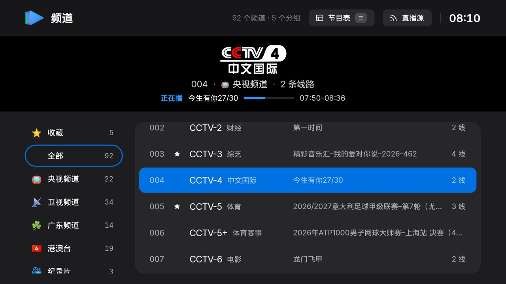
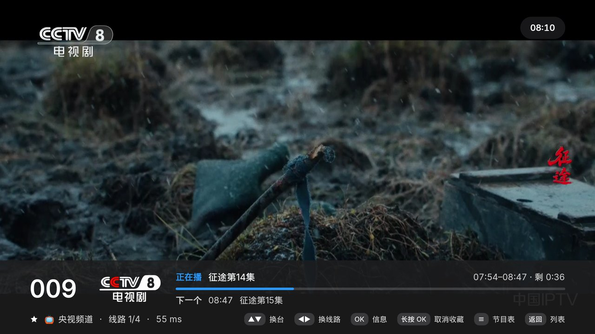
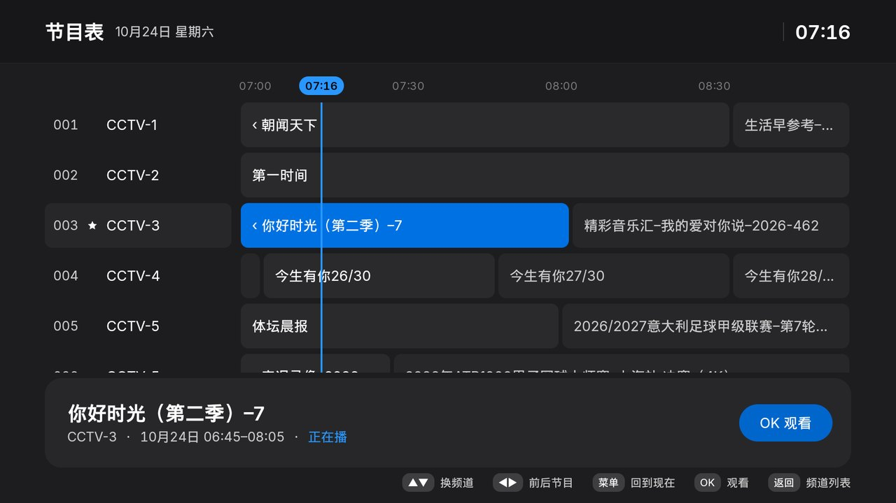

<p align="center">
  
</p>

<h1 align="center">tri.tv</h1>

<p align="center">
  为电视遥控器设计的 IPTV 直播应用，面向 Android TV（在 Sony BRAVIA / Android 10 上实测）。<br>
  <sub>An IPTV live-TV player for Android TV, built with Kotlin, Compose for TV and Media3.</sub>
</p>

<p align="center">
  
</p>

## 功能

- **一个直播源**：填一个 M3U / M3U8 地址即可，直播源有单独的设置页。支持 `tvg-id`、`tvg-name`、`tvg-logo`、`group-title`、`#EXTGRP`，以及 `#EXTVLCOPT` 里的 UA / Referer。
- **备用线路合并**：同一分组里同名（或同 `tvg-id`）的条目合并成一个频道，其余地址作为备用线路。
- **按延迟排线路**：后台测速每条线路，按「手动选择 > 可用线路按延迟 > 未测 > 失败」排序；当前线路播放失败时自动切到下一条。
- **更多音频格式**：内置 FFmpeg 音频解码，很多卫视用的 MP2 / AC3 音轨也能出声。
- **收藏**：长按 OK 收藏或取消收藏，收藏的频道单独成组，可以调整顺序。
- **节目表**：读取播放列表头部的 EPG 地址（`x-tvg-url` / `url-tvg`），列表和播放界面显示正在播 / 下一个节目；按遥控器的 ≡ 键打开节目表。
- **台标与类别**：显示频道台标，频道名旁标注类别（如「CCTV-5 体育」）。
- **加载动效**：缓冲转圈、列表骨架屏、导入按钮状态。
- **Apple 风格界面**：深色底、单一蓝色强调色、圆角统一 12。
- **按 Home 停止播放**：回到桌面时停掉直播流，再次打开时继续播同一个频道。
- 支持 HLS、DASH、RTSP 和普通 HTTP 流；允许明文 http，方便播放局域网内的源。

<p align="center">
  <br><br>
  
</p>

## 遥控器

| 按键 | 列表 | 播放 |
| --- | --- | --- |
| 上 / 下、频道 +/- | 移动焦点 | 换台 |
| 左 / 右 | 在分组和频道之间移动 | 换线路 |
| OK | 播放 | 显示 / 隐藏信息 |
| 长按 OK | 菜单：收藏、调整收藏顺序 | 收藏 / 取消收藏 |
| ≡ | 节目表 | 节目表 |
| 数字键 | 输入频道号 | 输入频道号 |
| 返回 | — | 回到列表 |

## 构建

需要 JDK 17+ 和 Android SDK（compileSdk 35，minSdk 23）。

```bash
./gradlew assembleDebug        # 输出 app/build/outputs/apk/debug/app-debug.apk
./gradlew testDebugUnitTest    # 单元测试
```

每次推送都会由 GitHub Actions 构建，Debug APK 可以在 Actions 运行页面的 Artifacts 里下载。

## 安装到电视

```bash
adb connect <电视IP>
adb install -r app/build/outputs/apk/debug/app-debug.apk
```

## 第三方资源

拉丁字母和数字使用 [Inter](https://github.com/rsms/inter) 字体（`app/src/main/res/font/inter_*.ttf`），以 SIL Open Font License 1.1 授权，许可证见 [`app/FONT-LICENSE-OFL.txt`](app/FONT-LICENSE-OFL.txt)。中文使用系统字体。音频解码使用 [Media3 FFmpeg 扩展](https://github.com/androidx/media/tree/release/libraries/decoder_ffmpeg)。
